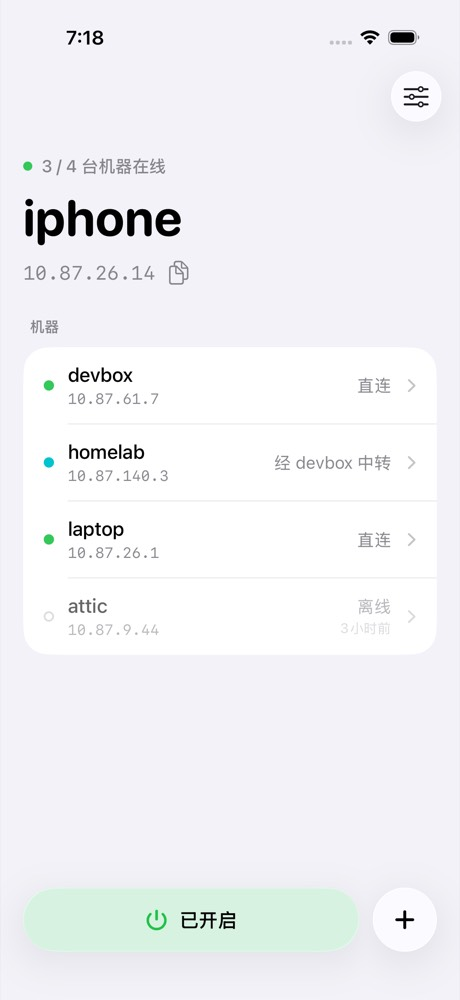
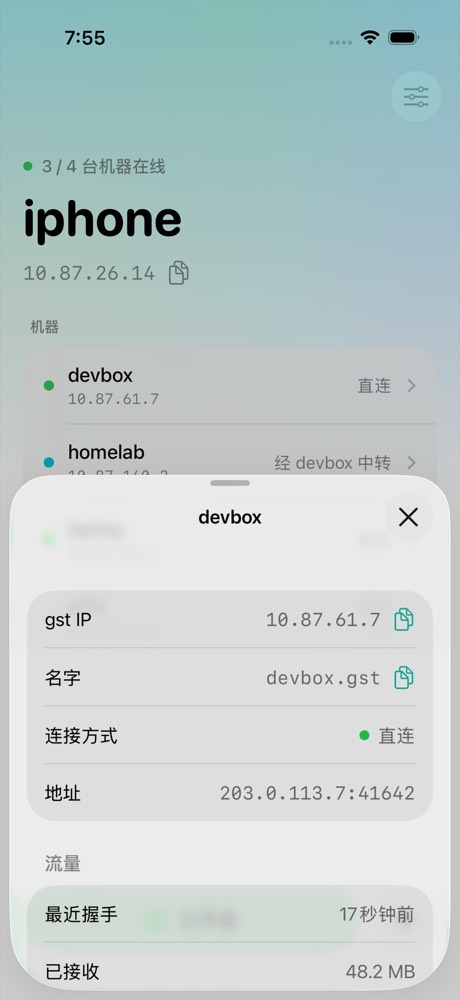

# gst

[English](README.md) | 简体中文

`gst`（go ssh tunnel）通过 SSH 把你的多台机器连成一个私有网络。体验接近 Tailscale，直接使用你已有的 SSH 登录：每台机器都有一个 gst IP 和名字 `<machine>.gst`，所有程序和协议都能用。流量是端到端的 WireGuard。网络允许时经 UDP 直连，否则经 SSH link 中转。支持 Linux 和 macOS，每台机器需要用一次 root；iPhone 和 iPad 上有 app（见 [iPhone 和 iPad](#iphone-和-ipad)）。

只需要三个词：

- **machine（机器）** 是一台运行 gst 的电脑。它有一个名字，例如 `devbox`，其他机器用 `devbox.gst` 访问它。
- **link** 是你从一台机器到另一台机器建立的 SSH 连接。相连的机器会互相转告各自能到达的机器，所以每台机器都能到达其他所有机器：`laptop` link 到 `homelab` 和 `devbox` 时，`homelab` 经由 `laptop` 就能到达 `devbox`，不需要 `devbox` 的任何凭据。
- **network（网络）** 是用 `gst add` 加进来的所有机器。每台机器在其中有一个 **gst IP**。机器离线时仍在网络里，直到 `gst remove` 把它移出。

## 安装

```bash
go install github.com/yangtau/ssh-tunnel/cmd/gst@latest
```

使用 Nix（需启用 flakes）：

```bash
nix profile add github:yangtau/ssh-tunnel
```

flake 指定了二进制缓存 `tau.cachix.org`，其中有每个 commit 构建好的 gst，Nix 会直接下载而不是自己编译。Nix 会询问是否使用这个缓存（`--accept-flake-config` 表示同意），而 Nix daemon 只允许其 `trusted-users` 中的用户使用。否则把缓存加到 `/etc/nix/nix.conf`（NixOS 上用 `nix.settings`），然后重启 daemon：

```
extra-substituters = https://tau.cachix.org
extra-trusted-public-keys = tau.cachix.org-1:tqAThmpvqthNsfMUwRlljsDKPW8147I/+yzRVZnxKsA=
```

不使用缓存时，Nix 会自己编译 gst，需要几分钟。

也可以在项目目录中执行：

```bash
nix build                 # result/bin/gst
nix run . -- --help
nix profile add .         # 从本地项目安装
```

Nix 包附带 Bash、Zsh 和 Fish 的补全脚本；其他方式安装时用 `gst completion bash|zsh|fish` 生成。

运行 `gst version` 查看已安装的版本：

```
gst 0.5.0
commit: d65d699c4e3f2b1a0987654321fedcba01234567
committed: 2026-11-09T08:12:00Z
protocol: 4
helper: 1
```

依次是发布版本、构建所用的 commit（构建时有未提交的修改则标 `(dirty)`）和该 commit 的时间、gst 协议版本，以及 `gst up` 安装的 network helper 的版本。只有协议版本相同的机器才能 link。`gst status` 显示每台机器的发布版本加短 commit，例如 `gst 0.5.0+d65d699`。

每台机器都要安装 gst。`gst up` 会在 `~/.local/state/gst/bin/gst` 放一个指向它的链接，其他机器的 link 运行的就是这一个，所以 gst 不必在 ssh 启动的登录 shell 的 `PATH` 中。升级或移动 gst 后，执行 `gst up` 重启它并更新这个链接；任何修改配置的命令也会重启它。

## 使用前准备

gst 在后台运行，不能输入口令，也不能确认未知的主机密钥。对于你要 link 的每台机器，需要：

1. **一个没有口令的私钥**，并已授权到那台机器上。建议单独创建一个：

   ```bash
   ssh-keygen -t ed25519 -N '' -f ~/.ssh/gst_ed25519
   ssh-copy-id -i ~/.ssh/gst_ed25519 user@devbox.example.com
   ```

2. **`~/.ssh/config` 里的 Host**，例如：

   ```
   Host devbox
     HostName ssh.example.com
     User user
     IdentityFile ~/.ssh/gst_ed25519
   ```

   也可以不写这一项，直接把目标地址交给 `gst add`，例如 `user@ssh.example.com`，ssh 选项写在 `--` 之后，例如 `gst add ssh.example.com -- -p 2222 -i ~/.ssh/gst_ed25519`。所有 SSH 设置（地址、用户、私钥、known_hosts、超时）都来自 `~/.ssh/config` 和这些选项，见 [ssh 配置](#ssh-配置)。

3. **known_hosts 里有该机器的主机密钥**：先用 `ssh devbox` 连接一次，核对并接受主机密钥。

4. **那台机器上有协议版本相同的 gst，并在那里执行过一次 `gst up`。** 它不需要自己的 link。gst 绝不替别的机器做设置：那里没执行过 `gst up` 时，`gst add` 会说明并给出命令，执行之后 link 自动连上。

这些只对建立 link 的机器有要求；另一端的机器只需要 gst、执行过 `gst up` 和能执行命令的 sshd（gst 使用登录会话而不是端口转发，所以 sshd 的 `AllowTcpForwarding` 不影响它）。对每个会话都强制执行固定命令的服务器无法被 link。

## 快速开始

在每台机器上执行一次 `gst up`：`laptop`、`devbox` 和 `homelab`。然后在 `laptop` 上添加另外两台：

```bash
gst up                     # 每台机器执行一次
gst add devbox             # ~/.ssh/config 中的 "devbox"
gst add homelab
gst status                 # 网络中的机器，每行一台
```

`gst status` 的输出类似这样（第一台是本机，显示为 `-`）：

```
4f1c9a27  laptop   gst 0.4.0  10.87.26.1   -
3f2a9c10  devbox   gst 0.4.0  10.87.61.7   direct
c07e5d11  homelab  gst 0.4.0  10.87.140.3  relay
```

之后任何程序都能用任何协议到达任何机器：

```bash
ping devbox.gst
ssh devbox.gst
psql -h devbox.gst
curl http://homelab.gst:8080/
```

link 在后台连接，连上后机器出现在列表里。没有 link 再能到达的机器留在列表里，显示为 `offline, seen 3h ago`。列表下方的 `Problems:` 部分列出本机未运行的 link，没有 link 通向、只能直接到达的机器（移除和改名不会在它们和本机之间传递；用 `gst add` 加一条通向它们的 link），以及本机不能加入网络的原因。`gst ping devbox` 检查到一台机器的路，打印 `reply from devbox (10.87.61.7): direct 203.0.113.7:41642, 12.3 ms`。

现在 `homelab` 能看到同一个网络：在 `homelab` 上，`gst status` 列出 `laptop` 和 `devbox`，`ping devbox.gst` 不需要到 `devbox` 的 link 也能通。

每个命令都可以用 `--help` 查看说明。在终端中，帮助使用粗体标题，命令和选项名为青色。经管道或重定向输出时是纯文本；设置 `NO_COLOR=1` 或 `TERM=dumb` 也可以在终端中关闭样式。

## 概念

| 词 | 是什么 | 命令 |
| --- | --- | --- |
| **machine** | 一台运行 gst 的电脑，有一个名字（默认是主机名）和一个随机 id | `gst name`、`gst status` |
| **link** | 从本机到另一台机器的 SSH 连接，在后台保持 | `gst add`、`gst unlink` |
| **network** | 加进来的所有机器，每台都有 gst IP 和名字 `<machine>.gst` | `gst add`、`gst remove`、`gst subnet` |
| **direct** / **relay** / **offline** | 到一台机器的包怎么走：经 UDP 直连，经 SSH link 中转，或者暂时没有路 | `gst status`、`gst ping` |

### 机器和 link

- 机器的名字给人看，也用于 `<machine>.gst`，不要求唯一；id 是唯一的。用 `gst name laptop` 修改名字。名字由 1-32 个小写字母、数字或 `-` 组成。
- `gst add devbox` 把这个 destination 上的机器加入网络，并让本机 link 到它。`devbox` 在另一个网络里时，两个网络合成一个；它已经在本网络里时，本机也 link 到它。再次添加同一个 destination 会替换它的 ssh 选项。
- link 用它的 destination 命名，也就是你交给 `gst add` 的 ssh 目标地址。流量可以沿 link 双向通过，所以 `devbox` 不需要自己的 link 就能到达 `laptop`。
- link 在后台运行，登录后自动启动，断线后自动重连。相连的机器会互相转告各自所知的网络，所以在任意一台机器上运行 `gst status` 都能看到整个网络。
- 机器离线时仍在网络里：名字和 gst IP 都保留，有 link 再到达它时自动回来。`gst status` 显示为 `offline, seen 3h ago`。
- link 属于建立它的机器：在那台机器上用 `gst unlink <destination>` 删除，其他什么都不变，另一端的机器仍在网络里。
- 在网络中任意一台机器上执行 `gst remove <machine>`，就为所有机器把它移出网络：它们断开到它的 link 并忘掉它，它一得知也断开自己的 link 并忘掉它们。`gst remove` 本机就是离开网络。被移除的机器只能用 `gst add` 回来，在它上面或在网络中的机器上执行都可以。

### 指定机器

所有命令都用 `<machine>` 指定机器，`<machine>.gst` 也按同样的方式解析。它按以下顺序解析，某一步只有在恰好匹配一台机器时才生效：

1. 去掉末尾的 `.gst`。
2. 机器的 id。
3. 机器的名字。
4. 至少 4 位的 id 前缀。

名字重复时，`gst status` 用 id 区分这些机器；此时请使用 id 或 id 前缀。`gst unlink` 改为接受 link 的 destination。

### 网络

网络让每台机器在一个私有网段里拥有 gst IP 和名字 `<machine>.gst`，任何程序都能用任何协议到达它：TCP、UDP 和 ping，例如游戏串流或屏幕共享。程序不需要任何设置。

- **root。** 创建网卡和路由需要 root，而 gst 以你的用户身份运行，所以由一个小的系统服务 **network helper** 只为 gst 做这件事，它运行一份 root 拥有的 gst。network helper 缺失或过期时，`gst up` 会显示它要执行的 `sudo` 命令，以及这条命令会改动本机的哪些内容，并先询问你，因为 `sudo` 不一定会要密码。之后 `sudo` 自己询问密码，gst 看不到密码。没有终端时 `gst up` 不询问，也什么都不执行；`gst up --yes` 不询问直接执行，但仍然显示命令。在已经 up 的机器上执行 `gst up` 不会改变任何东西，升级 gst 后也只有 network helper 变了才需要再次使用 root。机器会自动加入；在此之前，`gst status` 说明缺什么。
- **服务。** 其他机器能到达程序在所有地址或本机 gst IP 上打开的端口。用 `gst expose` 可以把回环端口、Unix stream socket 或本机能访问的其他地址暴露到本机 gst IP 上。
- **网段。** 所有机器共用一个网段（subnet）。第一台机器根据能应答的机器上的网卡和路由，选一个它们没有在用的 `/16`。两个网络合成一个时，保留较早那个网络的选择。`gst subnet 10.99.0.0/16` 为整个网络设置另一个网段：人的选择胜过 gst 的，最新的选择胜出，所有机器都迁移过去，gst IP 随之改变，离线的机器在回来时迁移。它必须是私有网段（在 `10.0.0.0/8`、`172.16.0.0/12`、`192.168.0.0/16` 或 `100.64.0.0/10` 之内）。某台机器把网段的一部分用在别处时（网卡的网段与它重叠，或者有落在它里面的路由），那台机器在 `gst status` 中报告。更宽的路由不算，比如 VPN 覆盖所有地址的路由，因为网段自己的路由更窄，优先生效。
- **gst IP。** 机器重启后 gst IP 不变。只承载 IPv4。
- **名字。** `<machine>.gst` 对所有程序生效，可以用机器的名字或 id 前缀。在 macOS 和使用 systemd-resolved 的 Linux 上，只有 `.gst` 交给 gst 解析。其他 Linux 上，这些名字在网络运行期间写在 `/etc/hosts` 中。
- **direct 和 relay。** WireGuard 对每个包做端到端加密，途中的机器只能看到密文。包一开始经 SSH link 中转，这些流量让两台机器经 link 寻找 UDP 直连：不需要任何配置，也不依赖外部服务器。前提是 UDP 能通，并且一台机器的某个地址（例如公网 IPv6 地址或共同网络上的地址）能被另一台访问；两台都在 NAT 后又没有这种地址的机器可能继续 relay，不过每台机器能从任何已经 direct 的机器得知自己的公网地址，常常因此打通。所有直连共用一个 UDP 端口，默认 15355，被占用时换一个；包按系统路由走，路由指向别的 VPN 就走 VPN。在 macOS 上，如果 VPN 或代理接管了路由，包改走它下面的网卡，因为代理会换一个端口重新发包，规则是直连也一样，防火墙随后就会丢掉这些包；只有那个 VPN 才能到达的地址因此继续 relay。gst 持续测量到对方各地址的延迟，有明显更快的地址时切过去，不打断任何连接；私网地址（比如同一个局域网里的）和别的地址差不多快时优先，因为这些包不经过公网。`gst status` 在每台机器后面显示 `direct` 或 `relay`，`gst status -v` 显示每条直连的地址。直连 45 秒没有流量就关闭，空闲的机器不再发探测包；之后的包先 relay，同时两台机器像第一次那样重新找直连。UDP 失效时，包在几秒内改为 relay，程序的连接不断。机器换到另一个网络时，gst 立刻重试，不用等之前失败的等待时间结束，运行中的直连也会得知新地址。直连建立后不再依赖 link，所以 SSH 断开或两台机器之间的机器休眠时，它继续运行，只在不通或两台机器之一被移出网络时关闭。relay 时，TCP 跑在 TCP 里，能用，但在丢包的网络上会变慢。
- **MTU。** 网卡的 MTU 是 1168 字节，适合每条直连。自己选择包大小的程序应该低于这个值，否则包会被分片。
- `gst down` 撤销 `gst up`：停止 gst，删除它的服务、网卡、路由、名字和 network helper。network helper 自己删除自己，所以不需要密码，下次 `gst up` 会重新询问。只留下配置和日志，机器的 gst IP、link 和暴露的端口都保留。gst 只是意外停止时，网卡、路由和名字也会消失，network helper 保留。

### 暴露服务

在能访问目标的机器上执行：

```sh
gst expose 8080 --port 5999                  # TCP：gst IP:5999 -> 127.0.0.1:8080
gst expose unix:///tmp/service.sock --port 6000
gst expose 5353 --udp                       # UDP：gst IP:5353 -> 127.0.0.1:5353
gst expose udp://service.example.com:5353 --port 5999
gst expose                                 # 列出暴露的端口
gst unexpose 5999                          # 只删除 TCP
gst unexpose 5999 --udp                    # 只删除 UDP
```

机器名为 `myhost` 时，其他机器使用对应协议连接 `myhost.gst:5999`。单独的端口表示回环地址，显式 TCP 目标使用 `tcp://host:port`。暴露端口默认与目标端口相同；Unix stream socket 必须指定 `--port`。TCP 和 UDP 可以共用端口。重复暴露相同规则不产生变化；修改目标需要先 unexpose。

规则由 gst 运行，退出终端或重启后仍然保留。监听**只绑定本机的 gst IP**，不会绑定通配地址或物理网卡地址。`waiting` 表示网络尚未就绪；`failed` 表示绑定失败，会自动重试；`running` 表示监听已开启，不代表目标健康；`stopped` 表示 gst 没有报告该规则。目标服务可以稍后启动，新连接会重新尝试。`gst status <machine>` 和 `gst ui` 也显示那台机器暴露的端口及其状态。

unexpose 或停止 gst 会关闭其连接。gst IP 变化时会关闭旧连接，并在新地址上重新监听。`gst down` 保留规则，下次 `gst up` 时恢复。暴露端口不会请求 root 权限；需要特权的端口会报告错误。

网络中的所有机器都能访问暴露的端口。目标看到的是 gst 发起的连接，不是原始客户端；Unix socket 权限按 gst 所属用户判断。转发保留字节和 UDP 报文，不改写 HTTP，也不终止 TLS。WireGuard 保护机器之间这一段，到目标这一段使用目标自身的协议。UDP 映射在空闲两分钟后回收，每条规则最多 256 个客户端，超限流量丢弃。不支持 Unix datagram socket、广播或组播转发。绑定 gst IP 限制的是目的地址，不是刻意路由过来的报文所进入的网卡。

### 信任

网络中的机器彼此信任。link 以你的用户身份登录，那里的 gst 只通过自己的 socket 接受它。一台机器在所有地址上打开的每个端口，对网络中的其他机器都是开放的；机器之间经 link 得知彼此的 WireGuard 密钥，所以它们信任 link 所信任的。只添加你信任的机器。网络中的任何机器都能用 `gst remove` 移除任何其他机器；能登录网络中某台机器的人就能往网络里添加机器，所以要彻底挡住一台被移除的机器，还要把它的密钥从其他机器的 `authorized_keys` 中删除。`gst down` 只停止本机，不把它移出网络。

## 命令

命令按 `gst --help` 的顺序排列。如何指定机器见[概念](#指定机器)。

| 命令 | 用途 |
| --- | --- |
| `gst up [--yes]` | 现在启动 gst，并在登录时启动；network helper 缺失或过期时，说明 `sudo` 要执行什么，询问后安装 |
| `gst add <destination> [-- <ssh option>...]` | 把一个 SSH destination 上的机器加入网络，并让本机 link 到它，在后台运行 |
| `gst status` | 列出网络中的每台机器：短 id、名字、gst 版本、gst IP，以及 `direct` 或 `relay`；然后是本机的问题 |
| `gst status -v` | 再列出所有机器之间的 link（`from -> to`、destination 和状态；本机的 link 断开也会列出，其他机器的只列运行中的），以及与每台机器的流量：怎么走（`direct` 和 `ip:port`，或 `relay`）、最近一次握手和收发字节数 |
| `gst status <machine>` | 经网络查询，显示一台机器的 gst IP、暴露的端口，以及从它出发或连到它的所有 link（`from -> to`、destination 和状态） |
| `gst ping <machine> [-c N] [-s BYTES] [-v]` | 每秒向一台机器发一个包并收回（默认 3 次），打印怎么走的和时间，最后打印丢了多少；`-s` 设置包的大小，超过网卡 MTU 时分片；`-v` 还检查 SSH link，并显示直连或没有直连的原因、双方最近两次尝试的过程（前一次显示上一条直连是怎么结束的），以及本机在哪里丢了包 |
| `gst expose [target] [--port port] [--udp]` | 不带 target 时列出本机暴露的端口；带 target 时把它暴露到本机 gst IP 上 |
| `gst unexpose <port> [--udp]` | 停止暴露一个端口，并关闭其连接 |
| `gst unlink <destination>...` | 删除本机到这些 destination 的 link；那些机器仍在网络里 |
| `gst remove <machine>` | 为网络中的所有机器把一台机器移出网络；移除本机就是离开网络 |
| `gst name [name]` | 显示或修改本机名字，并显示 id |
| `gst subnet [cidr]` | 显示网络的网段，或为所有机器修改它 |
| `gst ui [--port N]` | 在网页中显示网络 |
| `gst down [--yes]` | 撤销 `gst up`：停止 gst，删除它的服务和 network helper；其他机器不能 link 到本机 |
| `gst version` | 显示 gst 的发布版本、commit、协议版本和 network helper 版本 |

`destination` 是 `host`、`user@host` 或 `ssh://user@host:port`。ssh 选项写在 `--` 之后，例如 `-p 2222` 或 `-i ~/.ssh/gst_ed25519`；SSH 连接的其他设置都来自你的 ssh 配置（见 [ssh 配置](#ssh-配置)）。一台机器到同一个 destination 只有一条 link；再次添加会替换它的 ssh 选项。`gst add` 先检查是否有可用的无口令私钥、known_hosts 是否记录了服务器，不通过时不保存。之后它说明结果：`Added devbox to the network: 10.87.61.7, devbox.gst.`、`Joined the network through devbox: 10.87.61.7, devbox.gst.`（本机原来独自一台、devbox 已在一个网络里时）、`devbox is already in the network; this machine now also links to it.` 或 `Changed this machine's link to devbox.`

`gst remove` 会说明哪些机器只经由被移除的那台连到网络，它们在 link 到别的机器之前一直离线。在被移除的机器上，`gst status` 说明是谁、在什么时候移除了它。

`gst status` 每台机器一行，本机在最前面；最后一列说明到它的包怎么走：

| 方式 | 含义 |
| --- | --- |
| `-` | 本机 |
| `direct` | 经 UDP 直连 |
| `relay` | 经两台机器之间的 SSH link 中转 |
| `relay via devbox` | 经 SSH link 中转，途经列出的机器 |
| `offline, seen 3h ago` | 现在没有路通向它；它最后一次报告自己是这么久之前 |

加 `-v` 时，link 显示为两端的机器，例如 `laptop -> gateway`。`Problems:` 部分列出本机未运行的 link，以及本机不能加入网络的原因。link 的状态是 `running`、`connecting` 或 `down`（失败并重试中；显示最近一次错误，包括对方 gst 错误的第一行）。失败的 link 在 5 秒后重试，然后 10 秒，逐次翻倍，最长每 5 分钟一次，运行后重新计时。机器换到另一个网络时，失败的 link 立刻重试。

`gst ping` 的输出例如 `reply from devbox (10.87.61.7): direct 203.0.113.7:41642, 12.3 ms`，或者 `reply from gateway (10.87.2.9): relay via devbox, 41.3 ms`。这个包和所有程序的包走同一条路，经过网卡和 WireGuard，所以 `direct` 和 `ip:port` 说明到这个地址的直连是通的，时间和 `ping <machine>.gst` 差不多。直连由流量触发，所以最初几次回复可能是 relay。`-v` 还会检查承载网络控制的 SSH link：`SSH links: gateway answered via devbox in 41.3 ms`。这个时间更长，因为包括经过每台机器时建立通路的时间。没有收到回复时退出码为 1。

每个命令都接受 `--config <file>`。

## ssh 配置

除了 `gst add` 中 `--` 之后的选项，link 没有自己的 SSH 设置。每次连接时，gst 都会用 `ssh -G <选项> -- <destination>` 重新解析它的 destination，所以 link 跟随 `~/.ssh/config`，这些选项优先于它。修改该文件后，修改在 link 下次连接时生效。

| ssh 配置 | 用途 | 未设置时 |
| --- | --- | --- |
| `HostName`、`Port`、`User` | 地址和登录用户 | ssh 的默认值 |
| `IdentityFile` | 私钥，依次尝试，跳过不存在或有口令的 | ssh 的默认私钥列表 |
| `UserKnownHostsFile`、`GlobalKnownHostsFile` | 主机密钥校验 | ssh 的默认文件 |
| `ConnectTimeout` | 连接和登录超时 | 15 秒 |

gst 自己检查运行中的 link：两端每 15 秒发一次消息，45 秒什么都没收到的 link 重连。不使用 `ServerAliveInterval` 和 `ServerAliveCountMax`。

限制：

- 只使用没有口令的私钥，不使用 ssh-agent。
- 严格校验 known_hosts，不接受未知主机。
- link 不支持 `ProxyJump`、`ProxyCommand`、`HostKeyAlias`。要到达另一台机器背后的机器，请在两者上都运行 gst，经由前面的那台建立 link。

## 后台运行

- 每个用户有一个后台进程，即 gst daemon，运行 link 和网络，并接受其他机器的 link。它是一个用户级服务：Linux 上是 systemd 用户服务 `gst.service`，macOS 上是 launchd 代理 `local.gst`。`gst up` 或第一次修改配置时，gst 会安装它，不需要手动管理。别的机器 link 到本机时绝不会安装它。`gst down` 停止它并删除服务，`gst up` 恢复。
- gst 命令通过只有你能访问的 socket 与它通信：Linux 上是 `~/.local/state/gst/gst.sock`（设置了 `$XDG_STATE_HOME` 时在其下），macOS 上是 `~/Library/Application Support/gst/gst.sock`。
- 它退出后，服务会在 5 秒后重启它。
- 它的日志（也包含 link 的事件：已连接、失败、重连；直连的建立、结束及原因；机器睡眠了多久）：Linux 上在 journald（`journalctl --user -u gst`），macOS 上在 `~/Library/Logs/gst-daemon.log`。日志用一个短 id 指代 link，不写它的 destination。
- 为保护隐私，日志不记录服务器地址、用户、密钥路径和目标地址，也不记录对方 gst 返回的错误。这些只出现在交互式输出中：`gst status`、`gst ping` 和 `gst ui`。直连的地址同样不进日志。要看 link 失败的完整原因，执行 `ssh -v <destination>`。
- Linux 上，要让 link 在注销后继续运行、开机后自动启动，需要执行 `loginctl enable-linger "$USER"`；gst 发现没有开启时会提示。macOS 上，gst 在登录后启动、注销后停止。
- 服务运行的是 `gst daemon`，link 经 SSH 在对方机器上运行 `~/.local/state/gst/bin/gst peer-bridge`，`gst up` 没有在那里放 gst 时运行 `PATH` 中的 `gst peer-bridge`；这两个都不是需要你自己执行的命令。
- daemon 把它所知的网络（所有机器，以及被移除的机器）保存在 socket 旁边的 `state.json` 中，所以任何 link 连上之前它就知道整个网络。

### 网页

`gst ui` 在网页中显示网络，每隔几秒自动刷新：顶部是本机和所有机器之间的 link 关系图，下面列出每台机器的 gst IP、包怎么走和问题。展开一台机器可以看到它暴露的端口，以及所有从它出发或连到它的 link，写成 `from → to`，与 `gst status -v` 一致；link 属于它出发的那台机器，并附上建立它时用的 ssh destination。本机 gst 没有运行时，页面会说明。页面只用来查看；修改仍使用上面的命令。

`gst ui` 只在本机的 gst IP 上提供页面，直到按 Ctrl-C；网络里的任何机器（包括本机）都用 `<name>.gst` 打开，不监听 `localhost` 或其他地址。它需要网络已经起来，启动时打印地址，不会自动打开浏览器。

```bash
gst ui
gst ui --port 8370   # 在 devbox 上运行；然后在网络里任意机器上打开 http://devbox.gst:8370/#...
```

地址在 `#` 后带有一段随机密钥，页面需要它才能读取数据；`gst ui` 运行期间，拿到完整地址的人都能使用页面。每次运行生成新的密钥。

## iPhone 和 iPad

gst app 把 iPhone 或 iPad 加入网络。gst 在上面以 VPN 的方式运行：只有网络的网段和 `.gst` 下的名字经过它，对所有 app 生效，其他流量不受影响。手机有一把由 app 生成的、自己的 SSH 密钥，用它 link 到你的机器；手机上没有 `~/.ssh/config`。

<p>



</p>

app 没有上架 App Store。用 Xcode 从 [`ios/`](ios/README.md) 构建，需要一个能为 VPN 签名的 Apple Developer 账号。

加入网络的步骤：

1. 点 **+**，输入一台执行过 `gst up` 的机器的 SSH 登录地址 `user@host`，端口不是 22 时再填端口。
2. 第一次连接时 app 会显示服务器主机密钥的指纹。在服务器上用 `ssh-keygen -lf /etc/ssh/ssh_host_ed25519_key.pub` 查看它自己的指纹，核对后信任。
3. 接着 app 显示一条命令，用来把手机的公钥加入 `~/.ssh/authorized_keys`。以该用户登录那台机器并执行它，然后点 **重试**。**设置**中随时可以查看这把公钥。
4. app 添加 link 并开启 gst。iOS 会询问一次是否允许 gst 添加 VPN 配置。

首页列出所有机器，以及 `直连`、`中转` 或 `离线`，与 `gst status` 一致，问题显示在列表上方。点一台机器可以看到它的 gst IP 和名字、ping 它、把它移出网络。底部的开关用来开启和关闭 gst；开启期间 iOS 让它保持运行，重启后也会自动开启。**设置**中可以修改手机的名字、查看它的 link（左滑删除，相当于 `gst unlink`）和日志。

与其他机器的不同：

- 没有机器能 link 到手机，因为它不接受 SSH 登录。其他机器经由手机自己的 link 到达它，所以至少添加一台一直在线的机器。
- link 的 destination 是 `user@host` 或 `ssh://user@host:port`，手机使用自己的密钥和你在 app 中信任过的主机密钥，没有 ssh 选项。
- app 中没有 `gst expose`、`gst subnet` 和 `gst ui` 的对应功能，请在其他机器上执行。在那里运行的 `gst ui` 页面可以用手机的浏览器打开。
- 其他机器对手机执行 `gst ping` 时，包不能超过网卡的 MTU。
- 只要 gst 在运行，iOS 就显示 VPN 已连接，不管 link 是否连上。link 的状态请看 app。

## 升级

### 从 0.6 升级

加入网络的机器现在离线时仍在网络里，直到 `gst remove` 把它移出。gst 能读取 0.6 的配置并保留其中的 link。命令的变化：

| 0.6 | 现在 |
| --- | --- |
| `gst link <destination>` | `gst add <destination>` |
| `gst link <destination> --remote-gst <command>` | 在对方机器上执行 `gst up`，它把 gst 放到 link 找得到的地方 |
| `gst unlink <machine>` | `gst unlink <destination>` 只删除本机的 link；`gst remove <machine>` 把机器移出网络 |

用 `gst subnet` 选过的网段不保留；网络会重新选一个，在任意一台机器上 `gst subnet <cidr>` 会为所有机器设置它。在每台机器上执行一次 `gst up`，让 link 找得到那里的 gst。所有机器要一起升级：gst 拒绝与协议版本不同的 gst 通信，并同时指出双方。

### 从 0.5 及更早版本升级

现在的 gst 不读取 0.5 及更早版本的配置，每台机器从头开始：

```sh
rm ~/.config/gst/config.json
gst up
gst add devbox               # 在原来有 link 的机器上
```

每台机器会得到新的身份；用 `gst name` 重新设置名字。link 没有自己的名字，机器用它自己的名字访问，例如 `devbox.gst`；`gst connect`、代理、map、route、exit 和 `--json` 都已移除。只监听 loopback 或 Unix socket 的程序见[网络](#网络)。

## 排查问题

由外向内排查：`gst status` 显示机器是否连得上，并列出本机未运行的 link 及其最近一次错误，以及本机不能加入网络的原因；`gst ping <machine>` 检查到它的路，`gst ping <machine> -v` 显示直连为什么建立或没建立，或上一条为什么结束，比如合盖的笔记本上的 `this machine slept for 9.8s`；日志记录 link 的事件（Linux 上 `journalctl --user -u gst`，macOS 上 `~/Library/Logs/gst-daemon.log`）；`ssh -v <destination>` 显示 ssh 自己对登录过程的说明。`gst add` 也会先检查私钥和 known_hosts，不通过时不保存。

| 现象 | 处理 |
| --- | --- |
| `no usable key`、私钥 `passphrase-protected` | 按[使用前准备](#使用前准备)创建无口令私钥，并在 `~/.ssh/config` 中用 `IdentityFile` 指定 |
| `no host key for ...` | 用 `ssh <host>` 连接一次，记录主机密钥 |
| 主机密钥不匹配 | 确认该机器的密钥确实更换后，执行 `ssh-keygen -R <host>`，再用 `ssh` 连接一次 |
| link 为 `down`，错误来自对方 gst，例如 command not found | 那里还没有用你安装的 gst 执行过 `gst up`。在那里执行，例如 `ssh -t <destination> ~/.nix-profile/bin/gst up`；之后 link 自动连上 |
| link 为 `down`，错误是 `gst is not up on this machine; run gst up there`，或者 `gst add` 这样提示 | 在对方机器上执行 `gst up`，例如 `ssh -t <destination> gst up`；之后 link 自动连上 |
| `gst status` 显示 `This machine was removed from the network by ...` | 在本机执行 `gst add <destination>`，或在网络中的机器上 `gst add` 本机 |
| link 为 `down`，错误是 `... was removed from the network` | 它另一端的机器被移除了。用 `gst add <destination>` 把它加回来 |
| `speaks gst protocol 4 and … speaks 5; upgrade gst on the older side` | 升级协议版本较旧那台机器上的 gst；每条 link 的两端协议版本必须相同 |
| `config version 4 is too old` | 删除它指出的文件，重新添加机器（见[从 0.5 及更早版本升级](#从-05-及更早版本升级)） |
| `... is offline` | 没有运行中的 link 把本机和那台机器连起来。检查 `gst status`（离线的机器，以及未运行的 link） |
| `gst status <machine>` 或 `gst ping <machine>` 失败 | 那台机器必须可达，并运行协议版本相同的 gst；用 `gst status` 查看到它的路 |
| `gst is not running on this machine` | 执行 `gst up`；查看日志（`journalctl --user -u gst` 或 `~/Library/Logs/gst-daemon.log`） |
| 机器名匹配到多台机器 | 使用 `gst status` 中的 id 或 id 前缀 |
| `the network helper is not running` | 执行 `gst up`，之后机器会自动加入 |
| `the subnet ... overlaps ... on this machine` | 在网络中任意一台机器上用 `gst subnet <cidr>` 换一个网段 |
| `gst status -v` 的 `HANDSHAKE` 一直是 `never` | 需要有流量才会开始：试试 `ping <machine>.gst`。如果还是这样，检查另一台机器的 `gst status` 有没有报告问题 |
| 某台机器上的程序在它的 `.gst` 名字上没有应答 | 它可能只监听 `127.0.0.1` 或 Unix socket；见[网络](#网络)中的“服务” |
| macOS 阻止访问本地网络服务器 | 在“本地网络”权限提示或“系统设置 → 隐私与安全性 → 本地网络”中允许 gst，然后执行 `gst up` 重启 gst。终端获得授权不一定代表后台服务也获得授权 |

## 在脚本和 agent 中使用

- 结果输出到 stdout，是给人看的。错误输出到 stderr，以 `error:` 开头，通常还带一行 `hint:`，给出下一步该执行的命令。不是错误的提示以 `note:` 开头。
- 退出码：`0` 成功，`1` 执行失败（包括 `gst ping` 没有收到回复），`2` 参数无效。
- 所有命令都不需要交互输入，只有 `gst up` 和 `gst down` 在终端上执行 `sudo` 前会询问；`--yes` 跳过询问。

## 配置文件

配置保存在 `~/.config/gst/config.json`（设置了 `XDG_CONFIG_HOME` 时为 `$XDG_CONFIG_HOME/gst/config.json`），包括本机的名字和 id、link 及其 ssh 选项、暴露的端口。网段属于网络，daemon 把它和网络的其他信息一起保存在 `state.json` 中。可以用 `--config` 或环境变量 `GST_CONFIG` 指定其他文件，gst 在后台也会沿用它。每个用户只有一个 gst daemon，所以修改另一个配置文件会让它切换到那个文件。这个文件由 gst 维护，请用 gst 命令修改，不要手动编辑；多个 gst 命令同时执行也是安全的。
